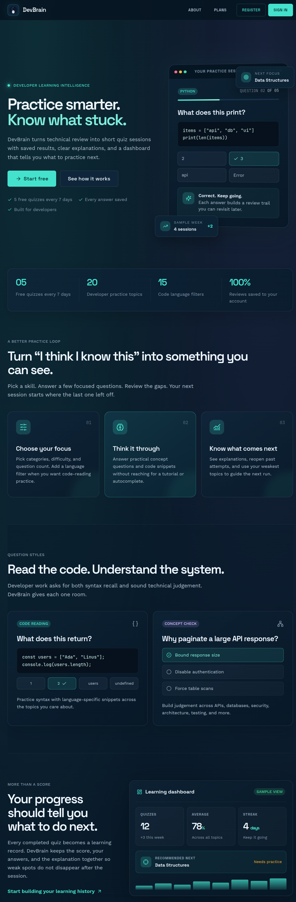

<div align="center">

# 

[](LICENSE)
[](https://www.python.org/)
[](https://flask.palletsprojects.com/)
[](https://github.com/RichardOyelowo/DevBrain)

</div>

DevBrain is a quiz app for practicing software topics. Learners take quizzes, review answers, and track progress. Admins manage the question bank through the app.

The question bank lives in the app database. Quiz selection does not call an external quiz service.

---



---

## Why I built it

I started DevBrain as a small quiz project. The first version depended on an outside question API, so I could not control question quality or keep a useful history. This version stores questions, attempts, and answers in the app.

## What it does

- Registration, login, password reset, and profile updates
- Quizzes by category, difficulty, and optional programming language
- Saved attempts, answer review, history, and progress stats
- A question library with draft, published, and archived states
- Admin tools for categories, languages, quiz presets, and JSON imports
- A responsive interface built with Jinja, CSS, and a small JavaScript file
- Free access for 5 quiz attempts per rolling 7 days
- Pro access for 50 quiz attempts per rolling 7 days
- Unlimited access with no weekly quiz cap

Admin accounts have no quiz cap. Paid checkout is not connected. Plan access must be assigned through trusted application or database operations.

## Quick start

These commands run the app locally with SQLite:

```bash
python -m venv .venv
source .venv/bin/activate
python -m pip install -r requirements.txt
export SECRET_KEY=local-development-key
export DATABASE_URL=sqlite:///instance/devbrain.db
python -m flask --app run.py db upgrade
python -m flask --app run.py ensure-catalog
python run.py
```

Open http://127.0.0.1:5000. The default account role is `user`. Admin bootstrap is off unless `ADMIN_BOOTSTRAP_ENABLED=true` is set before the first account registers. Turn it off after the intended admin account exists.

For production, set a unique `SECRET_KEY`, use PostgreSQL, and run migrations before starting Gunicorn. See [operations and plans](docs/operations-and-plans.md).

## Configuration

The app reads configuration from environment variables. In development it also loads a local `.env` file.

| Variable                                                   | Purpose                                                                              |
| ---------------------------------------------------------- | ------------------------------------------------------------------------------------ |
| `SECRET_KEY`                                               | Flask session signing. Required when `FLASK_ENV=production`.                         |
| `DATABASE_URL`                                             | SQLite or PostgreSQL connection URL.                                                 |
| `FLASK_ENV`                                                | Use `production` to enable production defaults.                                      |
| `ADMIN_BOOTSTRAP_ENABLED`                                  | Allows the first account on an empty database to become admin. Defaults to false.    |
| `AUTH_RATE_LIMIT`                                          | Auth POST limit per client IP and email. Defaults to 5.                              |
| `AUTH_RATE_WINDOW_SECONDS`                                 | Rate-limit window in seconds. Defaults to 900.                                       |
| `TRUST_PROXY_HEADERS`                                      | Reads forwarded client IP headers when set to true. Use only behind a trusted proxy. |
| `SESSION_COOKIE_SECURE`                                    | Secure cookie override. Defaults to true in production.                              |
| `WTF_CSRF_SSL_STRICT`                                      | Strict CSRF referrer checks. Defaults to true in production.                         |
| `MAIL_USERNAME`, `MAIL_PASSWORD`                           | SMTP account. `EMAIL` and `EMAIL_PASSWORD` are accepted as aliases.                  |
| `MAIL_SERVER`, `MAIL_PORT`, `MAIL_USE_TLS`, `MAIL_USE_SSL` | SMTP connection settings.                                                            |
| `REDIS_URL`                                                | Optional Redis-backed sessions.                                                      |

Do not commit real secrets. See [operations and plans](docs/operations-and-plans.md) for production settings and migration notes.

## Tests

```bash
python -m unittest discover -s tests -v
```

The test suite uses an in-memory SQLite database, matching the repository's CI workflow.

## Docs

- [Learning and quiz flow](docs/learning-guide.md)
- [Admin and question authoring](docs/admin-guide.md)
- [Frontend structure](docs/frontend-guide.md)
- [Plans and production operations](docs/operations-and-plans.md)

## Known limitations

- Checkout and subscription management are not connected.
- Auth rate limits are kept in each Gunicorn worker's memory. Multiple workers do not share counters.
- The app has no separate frontend build step.
- Production uses PostgreSQL. SQLite is for local development and the current test suite.

## License

See [LICENSE](LICENSE).
